  <a href="https://mcxiaocaibug.github.io">
    <picture>
      <source media="(prefers-reduced-motion: reduce)" srcset="./assets/profile-banner.png" />
      
    </picture>
  </a>

我在浏览器、服务器与边缘网络之间写代码，也为 Minecraft 做工具。喜欢把复杂的事物，做得安静、清楚、耐用。

**此刻：** `Rust / WebAssembly` · `Full-stack / Open Source` · `Minecraft`

### 最近在写

<!-- RECENT_WORK:START -->
- `10-03 20:41` 在 [Mcxiaocaibug.github.io](https://github.com/Mcxiaocaibug/Mcxiaocaibug.github.io) 提交 [feat: unify cosmic visuals, live GitHub telemetry and Maple Mono](https://github.com/Mcxiaocaibug/Mcxiaocaibug.github.io/commit/005bd9d0943ff953ae28b49c6b108870123928a7)
<!-- RECENT_WORK:END -->

### 两件作品

- [AzureDreamWebsite](https://github.com/Mcxiaocaibug/AzureDreamWebsite) — 一座现代、流动的社区网站
- [Neptunium Web](https://github.com/Mcxiaocaibug/neptunium-web) — Minecraft 基岩版投影文件管理系统

更多内容在 <a href="https://mcxiaocaibug.github.io">mcxiaocaibug.github.io</a> · Typeset in <a href="https://github.com/subframe7536/maple-font">Maple Mono</a>
